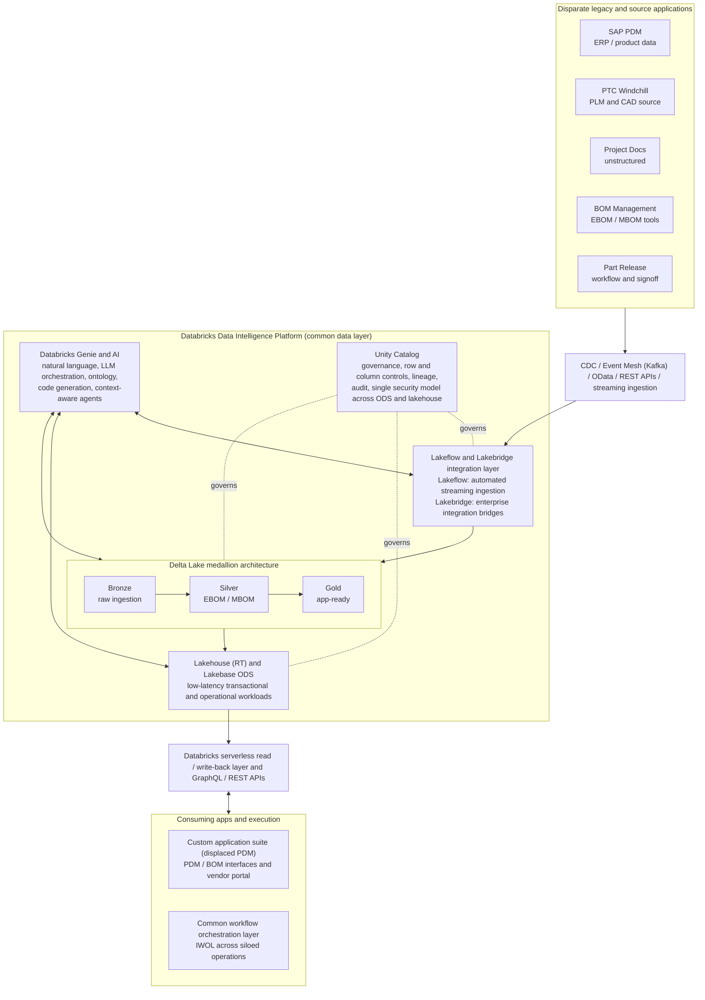
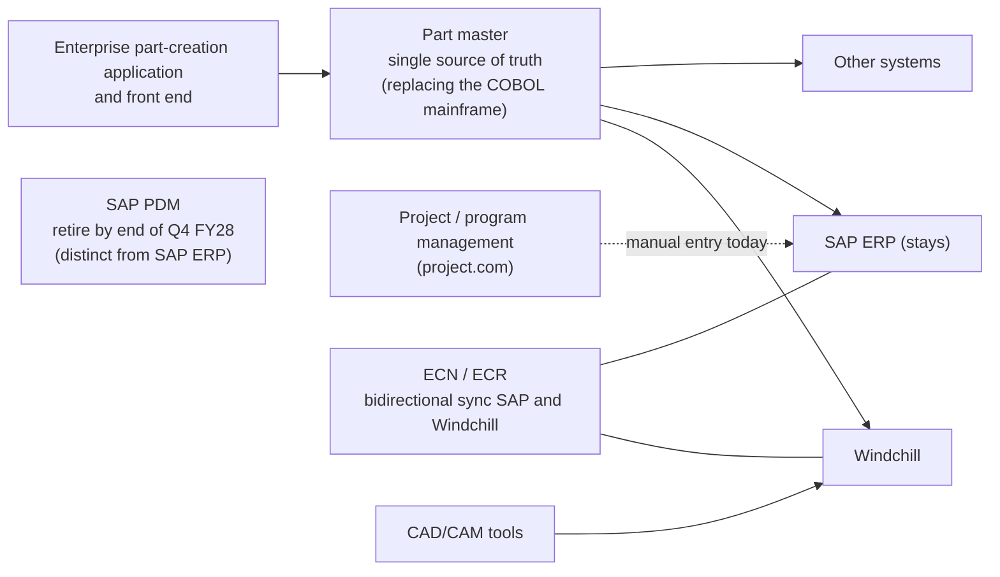

# Target-state architecture (Markdown version)

Recreated from [Product Lifecycle Management Architecture.png](../Product%20Lifecycle%20Management%20Architecture.png), then annotated with what the meeting record and the POC brief add. The meeting record says the diagram is a discussion aid, not a final design, so treat this the same way.

## 1. The diagram as drawn

## 2. The same architecture with the POC brief applied

The brief splits the box labelled "Lakehouse (RT) and Lakebase ODS" into two different things, and the diagram hides the write path. This view shows what the POC actually has to prove.

```mermaid
flowchart LR
    subgraph S["Simulated sources (plmgen)"]
        direction TB
        s1["SAP PDM"]
        s2["Windchill"]
        s3["Project / program mgmt"]
        s4["BOM mgmt"]
        s5["Part release"]
        s6["Project docs"]
    end

    subgraph L["Standard lakehouse (Delta, Unity Catalog)"]
        direction LR
        HIST["Lakebridge<br/>initial history load"]
        FLOW["Lakeflow<br/>continuous ingest"]
        B["Bronze"] --> Si["Silver"] --> G["Gold<br/>part and process-step state"]
    end

    subgraph LB["Lakebase (managed Postgres)"]
        direction TB
        SYN["Synced tables<br/>read-only ODS copy of Gold"]
        NAT["Native tables<br/>app-owned writes: status, approvals, workflow"]
    end

    RT["Lakehouse RT (Beta)<br/>read-only, 0.2 to 2 s analytics"]
    APP["Apps and AI agents<br/>where is this part now?<br/>alert next process owner"]

    S --> HIST --> B
    S --> FLOW --> B
    G == "sync mode A: continuous<br/>B: triggered, C: scheduled" ==> SYN
    SYN --> APP
    APP -- "writes" --> NAT
    NAT -- "synced back to Unity Catalog" --> RT
    G --> RT
    RT --> BI["AI/BI dashboards<br/>(no Genie on RT)"]
```

## 3. Platform choice rule (from the brief)

| Question | Answer |
|---|---|
| Need sub-100 ms latency? | Lakebase |
| Seconds are fine, many ACID writes from apps? | Lakebase |
| Seconds are fine, read-mostly point lookups by key? | Lakebase synced tables |
| Seconds are fine, aggregations or scans? | Standard lakehouse or Lakehouse RT |

| Option | Role | Latency | Writes |
|---|---|---|---|
| Standard lakehouse | ETL, batch, ML, Gold storage; about 90% of use cases | 5 to 30 s | via pipelines |
| Lakehouse RT (Beta) | dashboards, BI, high-concurrency analytics | 0.2 to 2 s | none, read-only |
| Lakebase | OLTP, point lookups, app back ends; 8 TB per instance | under 100 ms for lookups | yes, native tables only (synced tables are read-only) |

## 4. What the meeting record adds that the diagram does not show

Marked as additions to draw before the architecture is baselined. These are action items in the meeting record.

## 5. Differences between the three inputs

These need a decision from you, because they change what we build.

| Topic | Diagram | Brief or meeting record | Why it matters |
|---|---|---|---|
| Sources | five boxes | adds CAD/CAM tools, part master, part-creation app, project/program management | the generator has no part master and no program management source |
| Security | "single security model across ODS and lakehouse" | Unity Catalog and Postgres grants are different paths, with a risk of policy drift | the diagram promises something the platform may not deliver; this is a headline finding |
| Lakehouse RT | one box with Lakebase | separate products; RT is read-only, Beta, no Genie, UC tables only | the box should be split |
| Lakebridge | enterprise integration bridges | initial historical bulk load | verify what Lakebridge actually does in current documentation before building on this role |
| Freshness | not stated | within an hour (brief); about one minute for transactional approvals, up to two hours for orchestration (meeting); Windchill extract every four hours today | no single target; each use case needs its own |
| Write path | arrows to apps only | app writes go to native Lakebase tables, then sync to Unity Catalog | the diagram shows only reads |
| SAP PDM | a source | to be retired by end of Q4 FY28; SAP ERP stays | SAP PDM and SAP ERP must be drawn separately |
